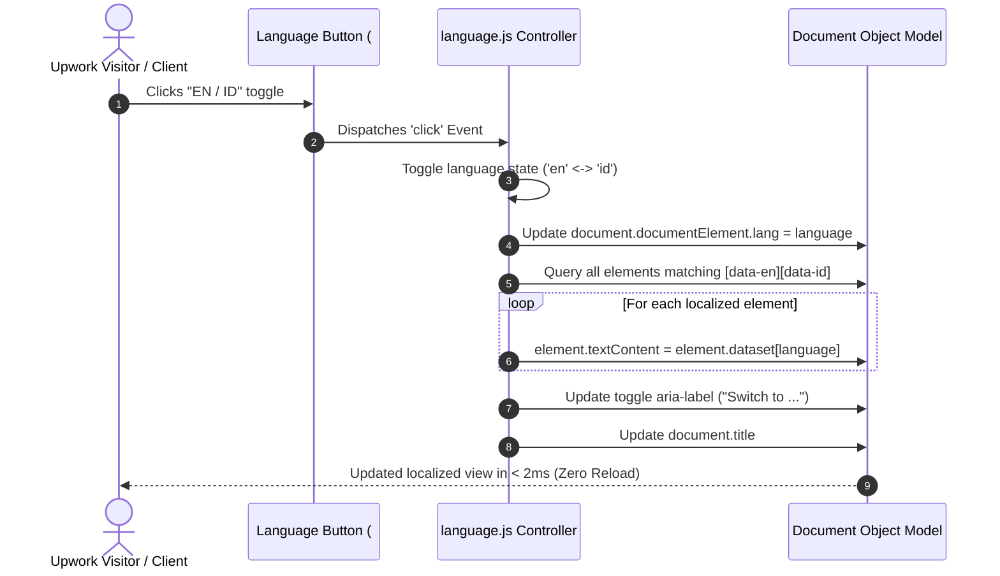
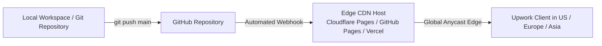

# System Architecture Document

## Project: Freelance Portfolio Website for Upwork
**Architecture Style:** High-Performance Static Jamstack / Zero-Server Footprint  
**Author:** Radika  
**Status:** Approved & Implemented Baseline  
**Version:** 1.0  
**Date:** October 2026  

---

## 1. Architecture Overview & Core Principles

### 1.1 Architectural Philosophy
This portfolio is engineered with the principle of **radical simplicity, zero latency, and maximum reliability**. 

When presenting portfolio samples to prospective Upwork clients, speed and visual polish are paramount. Every millisecond of delay or layout instability increases client drop-off. The architecture achieves sub-second loading speeds worldwide at zero operational cost by leveraging a **pure static front-end architecture** without server dependencies or build-step overhead.

### 1.2 Core Architectural Principles
1. **Zero Runtime Dependencies:** No client-side frameworks (no React, Next.js, Vue, or jQuery). Native browser APIs handle all styling, layout, and reactivity.
2. **Instant First Contentful Paint (FCP):** All critical markup and styling load synchronously without blocking hydration passes.
3. **Pure CSS Illustration System:** Complex visual elements (plant artwork, pots, botanical motifs) are rendered directly in the DOM using CSS gradients, transforms, and clip-paths, eliminating external image HTTP requests.
4. **Declarative DOM-Driven Internationalization (i18n):** Client-side localization runs via HTML5 `data-*` attributes and native DOM manipulation in under 2 milliseconds.
5. **Universal Static Portability:** The site can be hosted on any static file provider (GitHub Pages, Cloudflare Pages, Vercel, Netlify, or standard Apache/Nginx web servers) without configuration changes.

---

## 2. System Architecture Diagram

```mermaid
flowchart TD
    subgraph Client [Client Browser (Mobile / Tablet / Desktop)]
        UA[User-Agent / DOM Engine]
        subgraph Pages [Page Layer]
            IDX[index.html<br/>Portfolio Hub]
            BIZ[business.html<br/>English Landing Page]
            BIL[bilingual.html<br/>Bilingual Landing Page]
        end
        subgraph CoreAssets [Shared Assets Layer]
            CSS[styles.css<br/>Custom Properties + CSS Art]
            JS[language.js<br/>Vanilla i18n Controller]
        end
        subgraph ExtAssets [External CDN Layer]
            GF[Google Fonts CDN<br/>DM Sans + Playfair Display]
        end
    end

    subgraph Hosting [Edge CDN Hosting Layer]
        HOST[GitHub Pages / Cloudflare Pages / Vercel]
    end

    IDX --> CSS
    BIZ --> CSS
    BIL --> CSS
    BIL --> JS
    CSS -.-> GF
    HOST -->|Static Delivery HTTP/2 or HTTP/3| Client
```

---

## 3. Technology Stack & Architectural Decision Records (ADRs)

### 3.1 Technology Stack Summary

| Layer | Technology | Rationale |
|---|---|---|
| **Markup** | HTML5 Semantic Standard | Native accessibility, SEO crawlability, zero parsing overhead. |
| **Styling** | Modern CSS3 (Variables, Grid, Flexbox, `clamp()`, `clip-path`) | Responsive layouts without CSS frameworks (Tailwind, Bootstrap) to keep file weight under 8 KB. |
| **Logic** | Vanilla ECMAScript (ES6+) | Direct DOM manipulation for language toggling in ~10 lines of code. |
| **Typography** | Google Fonts (`DM Sans` + `Playfair Display`) | Pair modern humanist sans-serif with an elegant editorial serif for a boutique, trustworthy aesthetic. |
| **Visual Assets** | CSS Art & Inline SVG Icons | Zero HTTP image requests; instant vector scaling across all pixel densities. |
| **Hosting** | Static Edge CDN (Cloudflare Pages / GitHub Pages / Vercel) | Global edge caching, free tier, automatic SSL, 100% uptime SLA. |

---

### 3.2 Architectural Decision Records (ADRs)

#### ADR-01: Pure Vanilla Stack vs. Modern SPA / Static Site Generator (SSG)
- **Status:** Accepted
- **Context:** Deciding whether to build the portfolio using React/Next.js/Astro or plain vanilla HTML/CSS/JavaScript.
- **Decision:** Use **Vanilla HTML5, CSS3, and ES6+**.
- **Rationale:**
  - Upwork clients on mobile want instant page loads. Next.js/React introduces JavaScript bundle overhead (150KB+), hydration delay, and build complexity.
  - Plain HTML/CSS files can be opened by double-clicking in a browser locally, require zero `npm install` or maintenance, and never suffer from dependency drift or broken node_modules.
  - Demonstrates to clients strong foundational knowledge of core web fundamentals.

#### ADR-02: Dual Data-Attribute Localization vs. JSON Catalog / Subfolder Routes
- **Status:** Accepted
- **Context:** How to implement the English–Indonesian language toggle in `bilingual.html`.
- **Alternatives Considered:**
  1. *Subfolders (`/en/` and `/id/`)*: Requires maintaining two full HTML files in sync. Page reload required on toggle.
  2. *External `locales.json` via fetch()*: Adds an asynchronous network request and potential delay/CORS restrictions when opened locally.
  3. *Inline `data-en` and `data-id` attributes*: Keeps translations co-located with elements. Instant client-side text replacement.
- **Decision:** Use **Inline dual data-attributes (`data-en="..." data-id="..."`)**.
- **Rationale:**
  - Co-locating translations ensures that when copy changes, both languages are visible and reviewed together.
  - Zero-latency language switching without asynchronous fetch or layout jump.
  - Local filesystem compatibility (`file://` protocol works without CORS errors).

#### ADR-03: Vector CSS Artwork vs. External Raster Photography
- **Status:** Accepted
- **Context:** Hero and story section visuals for the "Ruang Rimbun" plant shop concept.
- **Decision:** Build the hero plant illustration and decorative backdrop using **pure CSS3 (`div.plant`, `div.stem`, `div.leaf`, `div.pot`)**.
- **Rationale:**
  - **Zero asset payload:** Eliminates multi-megabyte image downloads.
  - **Showcases technical skill:** Upwork clients with technical awareness recognize CSS illustration as high-level front-end proficiency.
  - **Crisp rendering:** Never pixelates regardless of display DPI or zoom level.

---

## 4. Component & Runtime Architecture

### 4.1 Page Breakdown & DOM Structure

```
portfolio-samples/
├── index.html          # Portfolio Hub (Main landing point for Upwork proposals)
├── business.html       # Sample 1: English-only Small Business Landing Page
├── bilingual.html      # Sample 2: Interactive Bilingual (EN/ID) Landing Page
├── styles.css          # Unified CSS stylesheet for all three pages
├── language.js         # Vanilla JavaScript localization runtime
├── START-HERE.md       # Upwork proposal scripts, job tracking & freelance guide
├── PRD.md              # Product Requirements Document
├── ARCHITECTURE.md     # System Architecture Document (this file)
└── dist/               # Optional distribution bundle for production deploy
```

### 4.2 Localization Runtime Flow (`language.js`)



#### Code Specification (`language.js`):
```javascript
const toggle = document.getElementById('language-toggle');
let language = 'en';

toggle?.addEventListener('click', () => {
  language = language === 'en' ? 'id' : 'en';
  document.documentElement.lang = language;
  document.querySelectorAll('[data-en][data-id]').forEach((element) => {
    element.textContent = element.dataset[language];
  });
  toggle.setAttribute('aria-label', language === 'en' ? 'Switch to Bahasa Indonesia' : 'Switch to English');
  document.title = language === 'en' 
    ? 'Ruang Rimbun — Bilingual Website Concept' 
    : 'Ruang Rimbun — Contoh Situs Dua Bahasa';
});
```

---

## 5. Styling Architecture & Design System

### 5.1 CSS Variables & Design Tokens (`:root`)

```css
:root {
  /* Surface & Background */
  --cream: #f8f5ec;      /* Warm, tactile canvas background */
  --paper: #fffdf7;      /* Clean card and container fill */
  
  /* Typography & Ink */
  --ink: #19382d;        /* Deep botanical forest green for primary text */
  --muted: #58685e;      /* Softened secondary text color */
  
  /* Brand Accent Palette */
  --green: #276b4b;      /* Primary actionable brand color */
  --green-dark: #184b36; /* Hover / active state button color */
  --lime: #dce9b5;       /* Accent tag and badge tint */
  --line: #dce3d6;       /* Subtle dividing borders */
  --gold: #dfb76b;       /* Focus-visible accessibility outline */
}
```

### 5.2 Responsive Layout Strategy
- **Container Strategy:** Universal `.wrap` class using `width: min(1140px, calc(100% - 48px)); margin: auto;` ensuring clean 24px margins on mobile and capping desktop width at 1140px.
- **Fluid Typography:** Headings utilize CSS `clamp()` functions (e.g., `font-size: clamp(50px, 6.2vw, 86px);`) guaranteeing proportional scaling without arbitrary media query jumps.
- **Single Breakpoint (`@media (max-width: 760px)`):** Transforms multi-column grids (`.hero-grid`, `.story-grid`, `.visit-grid`, `.hub-grid`, `.cards`) into natural single-column vertical flows.

---

## 6. Performance Engineering & Core Web Vitals (CWV)

### 6.1 Performance Target Metrics

| Core Web Vital | Industry Benchmark | Portfolio Architecture Target | Architectural Mitigation |
|---|---|---|---|
| **LCP (Largest Contentful Paint)** | < 2.5s | **< 0.8s** | Hero illustration built in CSS; no heavy banner image downloads. |
| **FID / INP (Input Latency)** | < 200ms | **< 20ms** | No heavy JavaScript tasks; event listener executes in < 2ms. |
| **CLS (Cumulative Layout Shift)**| < 0.1 | **0.00** | Strict explicit aspect ratios, min-heights on hero containers, and preloaded fonts. |

### 6.2 Font Loading Optimization
- External Google Fonts loaded with `font-display: swap` to prevent Flash of Invisible Text (FOIT):
  ```html
  <link rel="preconnect" href="https://fonts.googleapis.com">
  <link rel="preconnect" href="https://fonts.gstatic.com" crossorigin>
  <link href="https://fonts.googleapis.com/css2?family=DM+Sans:wght@400;500;600;700&family=Playfair+Display:wght@500;600;700&display=swap" rel="stylesheet">
  ```

---

## 7. Security, Privacy & Accessibility Architecture

### 7.1 Security Architecture
- **Zero Attack Surface:** Because there is no backend server, SQL database, user authentication, or form submission endpoint, standard OWASP risks (SQL injection, CSRF, server compromise) are completely eliminated.
- **Client Sanitization:** Dynamic text updates in `language.js` use `element.textContent = ...` instead of `element.innerHTML`, immunizing the app against Cross-Site Scripting (XSS).
- **Recommended Content Security Policy (CSP):**
  ```http
  Content-Security-Policy: default-src 'self'; style-src 'self' 'unsafe-inline' https://fonts.googleapis.com; font-src https://fonts.gstatic.com; script-src 'self';
  ```

### 7.2 Accessibility Architecture (a11y)
- **High-Contrast Focus Outlines:** Interactive elements feature explicit `:focus-visible` styling (`outline: 3px solid var(--gold); outline-offset: 3px;`).
- **Screen Reader Announcers:** 
  - Dynamic `aria-label` updates on the language toggle indicate state to assistive devices.
  - Pure CSS illustration marked with `role="img"` and descriptive `aria-label="Illustration of a leafy plant in a terracotta pot"`.
  - Decorative icons and marks set to `aria-hidden="true"`.

---

## 8. Deployment & CI/CD Pipeline

The project is structured to deploy anywhere in seconds. Below are the recommended free, reliable hosting targets for Upwork portfolios:



### 8.1 Deployment Options

1. **Option A: Cloudflare Pages (Recommended)**
   - Zero-configuration static deployment.
   - Fastest global DNS and Edge CDN caching across 300+ cities.
   - Setup: Connect GitHub repository &rarr; Build command: *none* &rarr; Output directory: `.` or `dist` &rarr; Deploy.

2. **Option B: GitHub Pages**
   - Free under `<username>.github.io/<repo-name>`.
   - Setup: In GitHub Repo Settings &rarr; Pages &rarr; Source: `Deploy from branch main` (`/root`).

3. **Option C: Vercel / Netlify**
   - Instant drag-and-drop or Git integration with free SSL certificates and automatic preview deployments for new branches.

---

## 9. Extensibility & Future Scaling

As the freelance business scales on Upwork, the architecture easily accommodates extensions without redesign:
- **Adding Real Client Case Studies:** Add additional `.sample-card` elements to `index.html` linking to new dedicated pages or PDF walkthroughs.
- **Direct Lead Capture / Booking:** Embed a lightweight Cal.com or Calendly button, or integrate a serverless form endpoint (e.g., Formspree or Formkeep) into `#visit` with zero backend setup.
- **Local Language Preference Persistence:** Add 2 lines of `localStorage` sync in `language.js` so returning visitors retain their language choice.
