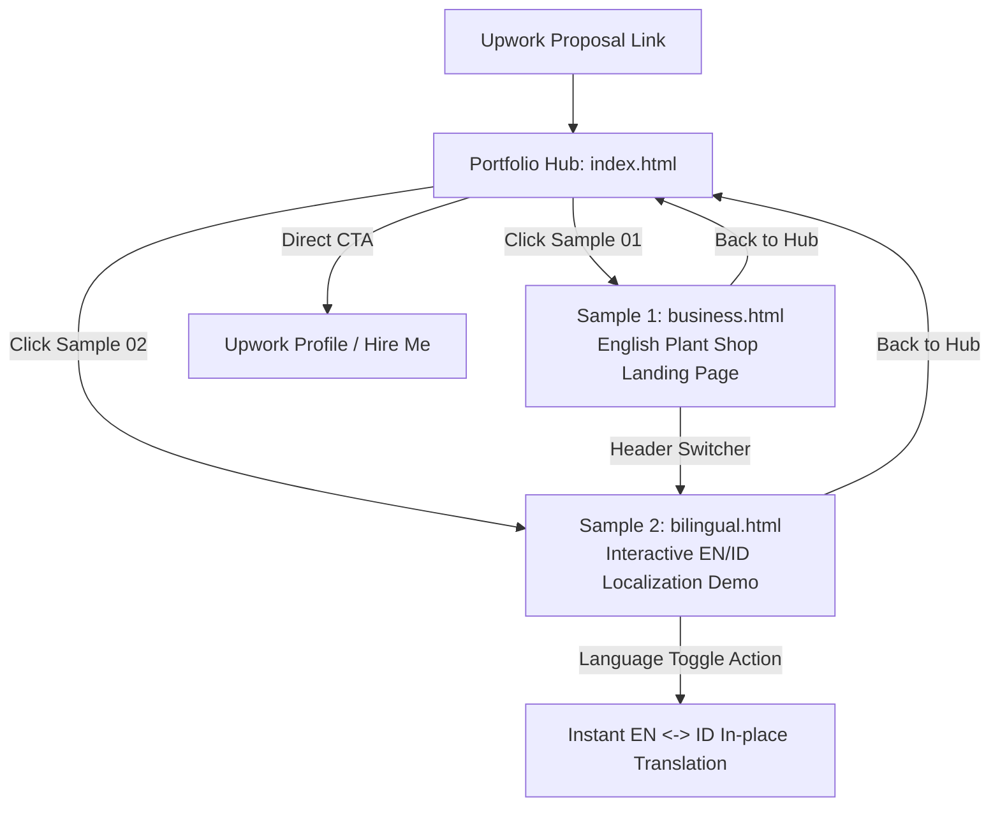

# Product Requirements Document (PRD)

## Project: Freelance Portfolio Website for Upwork
**Target Domain:** Web Design, Landing Page Development & Bilingual (English–Indonesian) Localization  
**Author:** Radika  
**Status:** Ready for Implementation / Baseline Defined  
**Version:** 1.0  
**Date:** October 2026  

---

## 1. Executive Summary & Objective

### 1.1 Objective
The primary objective of this portfolio website is to serve as a **high-converting proof-of-work asset** for winning freelance contracts on **Upwork**. It is designed specifically to validate the freelancer's profile claims:
1. Crafting clean, mobile-first, responsive landing pages for small businesses.
2. Building fast, lightweight web experiences using HTML, CSS, JavaScript, and platforms like WordPress and Wix.
3. Providing English–Indonesian website localization with natural phrasing and preserved UI design.

### 1.2 Core Problem Statement
Clients on Upwork review dozens of proposals per job post and spend an average of **15–30 seconds** vetting a candidate's portfolio link. Common reasons clients drop off include:
- Heavy websites that load slowly on mobile devices.
- Cluttered agency portfolios where individual contributions are ambiguous.
- Lack of relevant proof for specific small-business landing page and localization jobs.

### 1.3 Solution & Value Proposition
A fast, lightweight, distraction-free portfolio hub that immediately demonstrates:
- **Instant proof of craftsmanship:** Clean typography, aesthetic color palette, responsive layout, and pure CSS artwork.
- **Interactive capability:** A live, one-click English–Indonesian language toggle demonstrating functional localization without page reloads.
- **Frictionless client evaluation:** Upwork-friendly framing that clarifies the project as self-initiated concepts ready to be adapted for real businesses.
- **Direct call to action:** Seamless pathways directing prospective clients back to Upwork to hire the freelancer or submit an inquiry.

---

## 2. Target Audience & User Personas

### Persona A: International Small Business Owner
- **Profile:** Small business owner based in the US, UK, Australia, or Europe (e.g., boutique retail, local cafe, service provider, wellness studio).
- **Upwork Need:** Wants a straightforward 1-page landing page or redesign (often built in HTML, Wix, or WordPress) to establish an online presence.
- **Pain Points:** Overwhelmed by high agency rates, bloated frameworks, and freelancers who overcomplicate simple requirements.
- **What Convinces Them:** A clean, calming, professional sample with clear sections (Hero, Offerings, Story, Visit/Contact) and immediate mobile responsiveness.

### Persona B: Cross-Border Business / Regional Agency
- **Profile:** Regional enterprise, e-commerce brand, or marketing agency expanding into Indonesia or targeting dual English/Indonesian audiences.
- **Upwork Need:** Needs website content translated and adapted between English and Bahasa Indonesia without breaking layouts or button lengths.
- **Pain Points:** Literal machine translations that sound robotic or awkward, and translators who do not understand HTML/web formatting.
- **What Convinces Them:** Side-by-side or toggled bilingual demonstration showing culturally natural Indonesian and fluent English, with zero visual clipping.

### Persona C: Fast-Screening Upwork Recruiter / Project Manager
- **Profile:** Hiring manager filtering 30+ applicants against a tight budget ($100–$500 per milestone).
- **Time on Site:** Under 20 seconds.
- **What Convinces Them:** Zero load time, clear labels, obvious proof that the candidate can deliver, and clear scoping boundaries.

---

## 3. Product Vision & Information Architecture

### 3.1 Page Breakdown

| Page / Route | File | Core Purpose | Key Elements |
|---|---|---|---|
| **Hub / Index** | `index.html` | First landing point from Upwork; showcases service offerings and sample cards. | Headline, service positioning, Sample 1 Card, Sample 2 Card, Upwork badge/CTA, honesty disclaimer. |
| **Concept 1: One-Page Business Site** | `business.html` | Shows ability to build a complete, cohesive small-business landing page. | Demo ribbon, Navigation, Hero + CSS Illustration, 3 Category Cards, Story Section, Visit/Info Section, Footer. |
| **Concept 2: Bilingual Localization** | `bilingual.html` | Demonstrates real-time translation & localization capability between English and Indonesian. | All elements of Concept 1 + Interactive `EN / ID` button toggle, dynamic `aria-label`, title, and data attributes. |

---

## 4. Functional Requirements

### 4.1 Hub Page (`index.html`)
- **FR-HUB-01 (Value Proposition Header):** Display clear eyebrow tag (`Portfolio concepts · self initiated`), clear headline communicating core service capability, and a concise summary paragraph.
- **FR-HUB-02 (Interactive Sample Showcase Cards):**
  - Card 1: Link to `business.html` featuring thumbnail/icon, title (*"01 / One-page website"*), description, and hover micro-interaction.
  - Card 2: Link to `bilingual.html` featuring thumbnail/icon, title (*"02 / Website localization"*), description, and hover micro-interaction.
- **FR-HUB-03 (Freelance Profile & Upwork Integration):**
  - Prominent Upwork profile link / CTA button allowing visitors to message or hire immediately.
  - Brief freelancer bio matching the Upwork profile headline and summary.
- **FR-HUB-04 (Ethical Framing / Disclaimer):** Include a clear note stating the samples are self-initiated concept designs, building trust through transparency.

### 4.2 One-Page Business Concept (`business.html`)
- **FR-BIZ-01 (Demo Ribbon):** Top sticky/banner ribbon clarifying that the business is fictional and order flows are illustrative.
- **FR-BIZ-02 (Brand & Navigation):** Clean header with custom vector brand mark, brand name ("Ruang Rimbun"), anchor navigation links (`#plants`, `#story`, `#visit`), and a cross-link to the bilingual version.
- **FR-BIZ-03 (Hero Section):**
  - Compelling value proposition copy.
  - Primary CTA button scrolling smoothly to `#plants`.
  - Responsive CSS-only hero illustration (zero image load delay).
- **FR-BIZ-04 (Offerings Grid):** 3-column structured feature cards highlighting distinct categories with custom icons and concise copy.
- **FR-BIZ-05 (Narrative / Story Section):** Two-column editorial section conveying the shop's approach, demonstrating brand storytelling capability.
- **FR-BIZ-06 (Visit & Practical Information Section):** Location, opening hours, contact details placeholders, and an explanatory aside box indicating readiness for real business adaptation.
- **FR-BIZ-07 (Footer):** Minimalist footer with copyright and project context.

### 4.3 Bilingual Localization Concept (`bilingual.html`)
- **FR-LANG-01 (Zero-Reload Toggle):** Interactive toggle button (`#language-toggle`) in the navigation bar switching instantly between English (`en`) and Bahasa Indonesia (`id`).
- **FR-LANG-02 (Complete Copy Localization):** Every visible text element (ribbon, navigation, hero, CTAs, cards, story, visit info, footer) must update seamlessly using dual data-attributes (`data-en` and `data-id`).
- **FR-LANG-03 (Natural Idiomatic Indonesian):** Copy must avoid mechanical word-for-word translation in favor of natural Indonesian terminology suitable for modern urban businesses (e.g., *"Make room for something growing"* &rarr; *"Beri ruang untuk yang bertumbuh"*).
- **FR-LANG-04 (Metadata & Accessibility Updates):**
  - `document.documentElement.lang` updates dynamically (`en` vs `id`).
  - `document.title` updates dynamically.
  - `aria-label` on the toggle button updates to reflect the next accessible action.
- **FR-LANG-05 (Layout Preservation):** Translations must not break layout grid, cause awkward line wraps, or overflow button boundaries on mobile screens.

---

## 5. Non-Functional Requirements (NFRs)

### 5.1 Performance & Speed
- **NFR-PERF-01 (Load Time):** First Contentful Paint (FCP) < 0.8 seconds; Largest Contentful Paint (LCP) < 1.2 seconds on 4G connections.
- **NFR-PERF-02 (Lighthouse Score):** Target 95+ across Performance, Accessibility, Best Practices, and SEO.
- **NFR-PERF-03 (Asset Weight):** Total page weight < 50 KB (excluding external Google Fonts).
- **NFR-PERF-04 (Zero Runtime Dependencies):** Zero third-party JavaScript frameworks (no React, Vue, jQuery). Pure vanilla browser execution.

### 5.2 Mobile Responsiveness & Design
- **NFR-RESP-01 (Fluid Breakpoints):** Fully responsive from 320px mobile viewports up to 4K displays.
- **NFR-RESP-02 (Touch Friendly):** Interactive elements (buttons, links, toggles) have minimum touch target dimensions of 44x44px.
- **NFR-RESP-03 (Typography Scaling):** Use fluid `clamp()` sizing for headings and legible body font sizes (minimum 15px on mobile).

### 5.3 Accessibility (a11y)
- **NFR-A11Y-01 (WCAG Compliance):** Target WCAG 2.1 Level AA compliance.
- **NFR-A11Y-02 (Contrast Ratios):** Text-to-background contrast ratio >= 4.5:1 for body copy and >= 3:1 for large headings.
- **NFR-A11Y-03 (Keyboard Navigation):** Visible, high-contrast focus rings (`outline: 3px solid var(--gold)`) on all focusable elements.
- **NFR-A11Y-04 (Screen Readers):** Semantic HTML tags (`<header>`, `<main>`, `<section>`, `<article>`, `<aside>`, `<footer>`, `<nav>`) and proper `aria-hidden` attributes on decorative elements.

### 5.4 SEO & Social Link Previews
- **NFR-SEO-01 (Meta Tags):** Complete OpenGraph (`og:title`, `og:description`, `og:image`, `og:url`) and Twitter Card tags on all pages so portfolio links look polished when pasted into Upwork chat or proposal fields.
- **NFR-SEO-02 (Semantic Metadata):** Unique `<title>` and `<meta name="description">` per page.

---

## 6. Upwork Proposal Integration Strategy

### 6.1 Direct Proposal Deep Links
The site architecture supports direct deep-linking from Upwork proposals to maximize relevance:
- When bidding on **Small Business / WordPress / Wix landing page jobs**: link directly to `business.html`.
- When bidding on **Bilingual / Translation / Localization jobs**: link directly to `bilingual.html`.
- When pitching **general web support or full redesigns**: link to `index.html`.

### 6.2 Pre-tested Proposal Scripts
The repository maintains ready-to-use proposal templates aligned with the live portfolio:
- **Small-Business Pitch:** Emphasizes mobile-first layout, clear calls to action, fast turnaround, and simple handover.
- **Localization Pitch:** Emphasizes natural tone of voice, visual layout retention, and cross-cultural user experience.

---

## 7. Success Metrics & KPIs

| Metric | Target | Measurement Method |
|---|---|---|
| **Upwork Proposal View Rate** | > 35% click-through on portfolio links | UTM parameters / analytics on links included in proposals. |
| **Proposal-to-Interview Conversion** | >= 15% interview rate on tailored proposals | Upwork My Stats dashboard. |
| **Page Load Time (LCP)** | < 1.0s global average | Chrome User Experience Report (CrUX) / PageSpeed Insights. |
| **Language Toggle Engagement** | > 60% of visitors on `bilingual.html` toggle language | Client-side lightweight event telemetry or analytics. |
| **Client Feedback / Clarity** | Zero client confusion regarding sample vs live business | Upwork interview messaging feedback. |

---

## 8. Release Roadmap

- **Phase 1 (Current / MVP):**
  - Hub page, English concept, and Bilingual concept with vanilla JS language engine.
  - Complete mobile responsive styling and pure CSS artwork.
- **Phase 2 (Conversion Optimization):**
  - Add floating or dedicated "Hire on Upwork" / "Book a Consultation" banner.
  - Add language state memory (`localStorage` persistence so user language preference remains across pages).
  - Add Open Graph social preview cards and favicon.
- **Phase 3 (Expansion):**
  - Add case study snapshots for Wix and WordPress builds (screenshots + live demo links).
  - Add client testimonials / reviews section as Upwork contracts complete.
